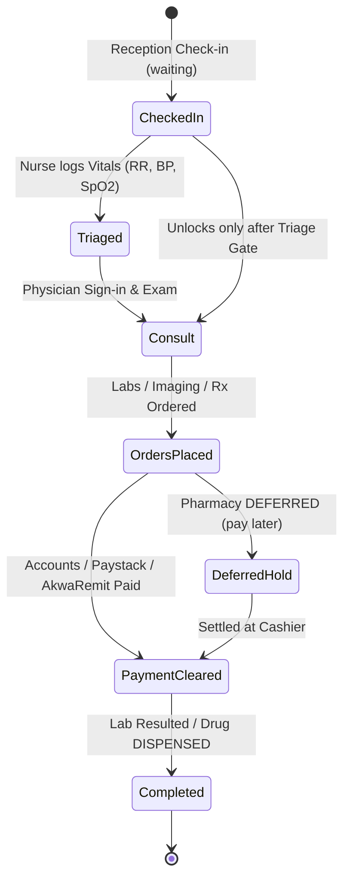

# Database Schema, ERD & Clinical Workflow State Rules

> **Source of truth:** [`apps/os/src/lib/db/postgres.ts`](../apps/os/src/lib/db/postgres.ts) (`ensureSchema`) and [`apps/admin/src/lib/db/postgres.ts`](../apps/admin/src/lib/db/postgres.ts) (`ensureMohSchema`).

MedCore uses PostgreSQL (Aurora/RDS) as its cloud system of record alongside structured multi-tenant Row-Level Security (RLS) and offline-resilient browser/LAN synchronization.

---

## 1. Core Facility Schema Entity-Relationship Diagram (`apps/os`)

All operational tables in `apps/os` (except the parent `facilities` table) are keyed and isolated by `facility_id`.

```mermaid
erDiagram
    facilities {
        text id PK
        text name
        text state
        text country
        jsonb config
        timestamptz created_at
        timestamptz updated_at
    }

    staff {
        text facility_id PK,FK
        text badge_id PK
        text full_name
        text role_key
        int clearance_level
        text status
        text pin_hash
        jsonb permissions
    }

    staff_biometrics {
        text facility_id PK,FK
        text badge_id PK
        text staff_name
        jsonb descriptor
        int version
        timestamptz enrolled_at
    }

    staff_otp_challenges {
        text facility_id PK
        text badge_id PK
        text email
        text otp_hash
        bigint expires_at
        int attempts
    }

    patients {
        text facility_id PK,FK
        text id PK
        text hospital_number
        text full_name
        text sex
        date date_of_birth
        text status
        jsonb meta
    }

    reception_visits {
        text facility_id PK
        text id PK
        text patient_id FK
        text hospital_number
        text queue_number
        text department
        text doctor
        text status
        text payment_status
        text visit_type
    }

    vital_signs {
        text facility_id PK
        text id PK
        text patient_id FK
        text encounter_id
        text bp
        int pulse
        numeric temp
        int spo2
        numeric weight
        text urgency
        text recorded_by
    }

    clinical_orders {
        text id PK
        text facility_id FK
        text patient_id FK
        text order_type
        text status
        text priority
        text ordered_by
        jsonb payload
    }

    prescriptions {
        text facility_id PK
        text id PK
        text patient_id FK
        text drug_name
        text dose
        text frequency
        text route
        text duration
        text status
        text prescribed_by
    }

    lab_results {
        text facility_id PK
        text id PK
        text patient_id FK
        text order_id FK
        text test_name
        text result_summary
        text flag
        text status
        text validated_by
    }

    inpatient_beds {
        text facility_id PK
        text id PK
        text ward
        text bed_no
        text status
        text patient_id FK
        text doctor
    }

    invoices_receipts {
        text facility_id PK
        text id PK
        text patient_id FK
        text order_id FK
        text source
        numeric amount_ngn
        text status
        text paid_via
        text payment_ref
    }

    accounts_requests {
        text facility_id PK
        text id PK
        text patient_id FK
        numeric amount_ngn
        text status
        text invoice_number
        text paid_reference
    }

    akshia_claim_batches {
        text facility_id PK
        text batch_id PK
        text period_month
        text scheme
        int claim_count
        numeric total_amount_ngn
        text status
        text signature_hash
    }

    akshia_claims {
        text facility_id PK
        text id PK
        text claim_number
        text enrollee_id
        text icd11_code
        text authorization_code
        numeric total_amount_ngn
        text status
        text batch_id FK
    }

    hie_referrals {
        text id PK
        text facility_id
        text target_facility_id
        text specialty
        text priority
        text status
        text hospital_number
        text patient_shid
        text patient_consent_token
        text bed_lock_id
    }

    clinical_audit_ledger {
        text facility_id PK
        text id PK
        text actor
        text actor_badge
        text category
        text severity
        text action
        text entity
        text entity_id
        text prev_hash
        text row_hash
    }

    merkle_anchors {
        text facility_id PK
        text anchor_id PK
        int leaf_count
        text merkle_root
        text network
        text external_tx_hash
        text status
    }

    care_bookings {
        text facility_id PK
        text id PK
        text booking_ref
        text shid
        text department
        text status
    }

    care_reminders {
        text facility_id PK
        text id PK
        text patient_id
        text track
        date due_date
        text channel
        text status
    }

    facilities ||--o{ staff : "employs"
    facilities ||--o{ patients : "registers"
    facilities ||--o{ clinical_orders : "scopes"
    staff ||--o| staff_biometrics : "enrolls face"
    staff ||--o| staff_otp_challenges : "2FA OTP"
    patients ||--o{ reception_visits : "checks in"
    patients ||--o{ vital_signs : "records vitals"
    patients ||--o{ clinical_orders : "receives orders"
    patients ||--o{ prescriptions : "prescribed"
    patients ||--o{ lab_results : "tested"
    patients ||--o| inpatient_beds : "occupies"
    patients ||--o{ invoices_receipts : "billed"
    patients ||--o{ accounts_requests : "awaiting payment"
    clinical_orders ||--o| lab_results : "fulfills"
    clinical_orders ||--o| prescriptions : "rx projection"
    clinical_orders ||--o{ invoices_receipts : "charges"
    akshia_claim_batches ||--o{ akshia_claims : "aggregates"
    facilities ||--o{ clinical_audit_ledger : "logs"
    facilities ||--o{ merkle_anchors : "seals"
    facilities ||--o{ care_bookings : "schedules"
    facilities ||--o{ care_reminders : "dispatches"
```



### Auxiliary Key-Value & Coordination Tables (`apps/os`)

| Table | Primary Key | Purpose |
|-------|-------------|---------|
| `facility_kv` | `(facility_id, key)` | Multi-device JSON state sync (`medcore_os_*` keys) with relational projection via `projectKeyToRelationalTables()` |
| `form_drafts` | `(facility_id, form_type, draft_id)` | In-progress form state with automatic 24-hour TTL (`expires_at`) |
| `notifications` | `id` | Facility-scoped real-time clinical, lab critical, and revenue notifications |

---

## 2. Ministry of Health (MOH) Portal Tables (`apps/admin`)

Defined in `ensureMohSchema()` inside [`apps/admin/src/lib/db/postgres.ts`](../apps/admin/src/lib/db/postgres.ts) against the shared PostgreSQL cluster for statewide governance (de-identified telemetry, never raw bedside clinical notes):

| Table | Purpose | Key Status / Lifecycle Columns |
|-------|---------|--------------------------------|
| `moh_directives` | Commissioner circulars & mandatory statewide directives | `status` (`active`), `acknowledged_facilities` |
| `moh_audits` | Facility compliance inspection schedule & violation counts | `status` (`scheduled`), `findings_count`, `critical_violations` |
| `moh_staff_transfers` | Cross-facility workforce / surge redeployments | `status` (`pending` \| resolved) |
| `moh_facility_overrides` | Accreditation, licensing, emergency posture & unlawful-practice flags | `operational_status`, `accreditation_status`, `unapproved_practice_flag` |
| `moh_alerts` | Hyper-local outbreak alerts & containment switches | `severity`, `containment_active` |
| `moh_private_facilities` | Private hospital licensing & geolocation registry | `operational_status`, `accreditation_status`, `license_expiry` |
| `moh_enforcement_actions` | Facility sealing & inspection enforcement records | `action_type`, `status` (`active_seal`) |
| `moh_hrh_recruitment` | Health workforce vacancy & deployment tracking | `stage` (`open`) |
| `moh_supply_equipment` | Statewide drug stockout & cold-chain monitoring | `quantity`, `reorder_level`, `functional_status` |
| `moh_idsr_reports` | Integrated Disease Surveillance & Response (IDSR) tallies | `status` (`submitted`) |
| `moh_citizen_grievances` | Public facility quality / feedback ticket resolution | `status` (`open`), `turnaround_hours`, `resolved_at` |

---

## 3. Multi-Tenant Row-Level Security (RLS)

Every server-side DB transaction operating on facility data goes through `withTenantClient(facilityId, fn)` in [`apps/os/src/lib/db/postgres.ts`](../apps/os/src/lib/db/postgres.ts):

```sql
BEGIN;
SELECT set_config('app.current_facility_id', '<facilityId>', true);
-- All queries execute under RLS scope
COMMIT;
```

- **22 operational tables** have `ENABLE ROW LEVEL SECURITY` turned on (`patients`, `staff`, `clinical_orders`, `notifications`, `facility_kv`, `form_drafts`, `vital_signs`, `prescriptions`, `lab_results`, `invoices_receipts`, `inpatient_beds`, `reception_visits`, `accounts_requests`, `staff_biometrics`, `staff_otp_challenges`, `clinical_audit_ledger`, `hie_referrals`, `akshia_claims`, `akshia_claim_batches`, `merkle_anchors`, `care_bookings`, `care_reminders`).
- **Standard tenant policy (`facility_isolation_policy` on 21 tables):** `facility_id = COALESCE(NULLIF(current_setting('app.current_facility_id', true), ''), facility_id)`.
- **Inter-facility HIE policy (`hie_shared_facility_policy` on `hie_referrals`):** Permits visibility to both the referring `facility_id` and the receiving `target_facility_id`.

---

## 4. Clinical & Financial Workflow State Rules (Immutability & Gates)



| Domain | Source | State Progression | Strict Locking, Gating & Immutability Rules |
|--------|--------|-------------------|---------------------------------------------|
| **OPD Visit Queue** | `receptionOpsStore.ts` | `waiting` → `with_provider` / `admitted` → `completed` / `cancelled` / `no_show` | Terminal states (`completed`, `cancelled`, `no_show`) are frozen against automatic stage transitions (`autoAdvancePatientVisitStage` short-circuits when already terminal). |
| **Triage-Before-Consult Gate** | `AdminSettings.tsx` | Preview → Clinical Consult | When enabled, the physician consultation workspace stays in **read-only preview** until a nurse logs respiratory rate, blood pressure, and SpO₂. |
| **Clinical Orders & Prescriptions** | `clinicalEventBus.ts`, `PharmacyDispensingSuite.tsx`, `rolePermissionsStore.ts` | `ordered` → `accepted` → `in_progress` → `resulted` \| `cancelled` (Pharmacy: `ACTIVE` / `DEFERRED` → `DISPENSED`) | 1) **Prescribing RBAC:** `roleCanPrescribe()` restricts Rx ordering to `doctor`, `surgeon`, `medical_director`, and `hospital_admin`.<br>2) **Pay-Before-Service Gate:** `paymentCleared` defaults to `false`; pharmacy/lab release verifies invoice clearance unless explicitly placed on `deferredForPayment` (`DEFERRED`) hold.<br>3) **Dispensed Lock:** Once marked `DISPENSED` (`dispensedAt`, `resulted`), inventory is decremented and the dispense action is sealed in the audit ledger. |
| **Clinical Notes (SOAP / Discharge)** | `clinicalUxStores.ts`, `ClinicalUxSuite.tsx` | Draft (`signed: false`) → Signed (`signed: true`, `signedAt`) | Signing captures `signed: true`, `signedAt` ISO timestamp, `author`, and `authorBadge`. Signed clinical notes represent legally attested records; post-signature changes should be entered as timestamped addendum notes rather than silently altering historical text. |
| **Digital Legal Consents** | `DigitalConsentSuite.tsx` | Unsigned → Signed Consent Record | Captures `signatureDataUrl`, `signedAt`, `risksExplained`, `witnessName`, and a deterministic `verificationHash` bound to the patient and procedure. |
| **HIE Inter-Facility Referrals** | `hieReferralEngine.ts`, `/api/referrals/hie` | `pending_acceptance` → `bed_locked` → `in_transit` → `arrived_admitted` → `completed_discharged` | Transitioning to `bed_locked` reserves `bed_lock_id` / `bed_ward` at the target hospital; cross-facility read/write requires matching `facility_id` or `target_facility_id` under RLS. |
| **AKSHIA Claims & Batches** | `postgres.ts`, `/api/akshia/claims` | Claim: `draft` → `submitted` → `paid`; Batch: `submitted` | Batches record `claim_count`, `clean_count`, `blocked_count`, and cryptographic `signature_hash` at submission. |
| **Revenue & Cash Settlement** | `akwaRemit` / `paystackLedgerStore.ts` | `unpaid` / `awaiting_payment` → `pending` (cash) → Batch Settled (`paid`) | Counter **cash collections stay `pending`** until an Accountant reconciles and executes batch settlement (`/api/akwaremit/batch-settle`) — frontline cashiers cannot bypass directly into Direct AkwaRemit settlement. |
| **Audit Ledger & Merkle Anchors** | `audit/route.ts`, `merkleAnchorEngine.ts` | Append-Only (`ON CONFLICT DO NOTHING`) → `sealed_local` / `anchored_onchain` | Rows in `clinical_audit_ledger` are append-only (`DO NOTHING` on conflict) and chained via `prev_hash` → SHA-256 `row_hash`. Periodic Merkle anchors seal batches of row hashes without exposing any raw PHI. |
| **Workstation Inactivity Lock** | `InactivityLockGuard.tsx`, `wallClockTimer.ts` | Active → Warning (`60s` wall-clock) → Auto-Logout / Lock + PHI Scrub | Uses persisted wall-clock timestamps (`medcore_os_last_activity_at_v1`) rather than `setInterval` ticks so minimized/backgrounded apps still lock/expire accurately on resume and invoke `scrubPhiOnLogout()`. |
